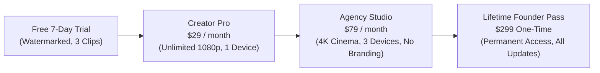

# ClipVault Monetization & Pricing Model

## 1. Monetization Philosophy: Local-Compute = 95%+ Gross Margins
Unlike cloud SaaS companies that pay Amazon AWS or Google Cloud \$0.05–\$0.15 per rendered video minute (destroying margins as users scale), **ClipVault renders on the client's local GPU/CPU**.

* **Cloud SaaS Margin**: 50%–70% (Heavy GPU server bills).
* **ClipVault Margin**: **95%+** (Server costs are limited strictly to license validation and minimal API calls).

---

## 2. Customer Pricing Tiers

### Tier 1: Free Trial (Acquisition Funnel)
- 7-Day trial period.
- 5 free viral clip exports.
- Subtle ClipVault watermark badge.
- Goal: Convert 12%–18% of trial users into paid Pro subscribers within 48 hours.

### Tier 2: Creator Pro — \$29 / month (or \$249 / year billed annually)
- **Target**: Solo creators, YouTubers, TikTokers, Skool clipping affiliates.
- **Features**:
  - Unlimited video clip rendering (Zero credit caps).
  - 1080p Full HD vertical master exports.
  - Full AI face-tracking & virtual camera auto-reframe.
  - Animated karaoke typography & auto-emojis.
  - Fast-slicing YouTube downloader.
  - 1 active desktop device license.

### Tier 3: Agency Studio — \$79 / month (or \$699 / year billed annually)
- **Target**: Content agencies, social media managers, podcasters, video editors with clients.
- **Features**:
  - Everything in Creator Pro.
  - 4K Ultra Cinema 60 FPS master exports.
  - 3 concurrent desktop device activations.
  - Custom branding & preset watermarks.
  - Priority multi-thread batch processing.
  - Whitelabel client metadata exports.

### Tier 4: Lifetime Founder Pass — \$299 One-Time (Early Growth Special)
- Permanent commercial license with lifetime core updates.
- 2 concurrent device seats.
- Instant cash flow generation during early launch phases (\$30,000 generated per 100 copies).

---

## 3. Financial Projections (Year 1)

| Milestone | Active Pro Subs (\$29/mo) | Active Agency Subs (\$79/mo) | Lifetime Sales (Cumulative) | Monthly Recurring Revenue (MRR) | Annual Run Rate (ARR) |
| :--- | :--- | :--- | :--- | :--- | :--- |
| **Month 3** | 75 | 15 | 40 (\$12,000) | **\$3,360** | \$40,320 |
| **Month 6** | 250 | 45 | 100 (\$30,000) | **\$10,805** | \$129,660 |
| **Month 9** | 600 | 120 | 180 (\$54,000) | **\$26,880** | \$322,560 |
| **Month 12** | 1,200 | 250 | 250 (\$75,000) | **\$54,550** | **\$654,600** |

---

## 4. Payment Infrastructure: Merchant of Record (Lemon Squeezy)
- **Automatic Sales Tax / EU VAT Compliance**: Lemon Squeezy handles global tax filing in 130+ countries.
- **Chargeback Protection**: Built-in fraud detection.
- **Affiliate Program Integration**: Automated 30%–40% payouts for clipping influencers and Skool leaders.
