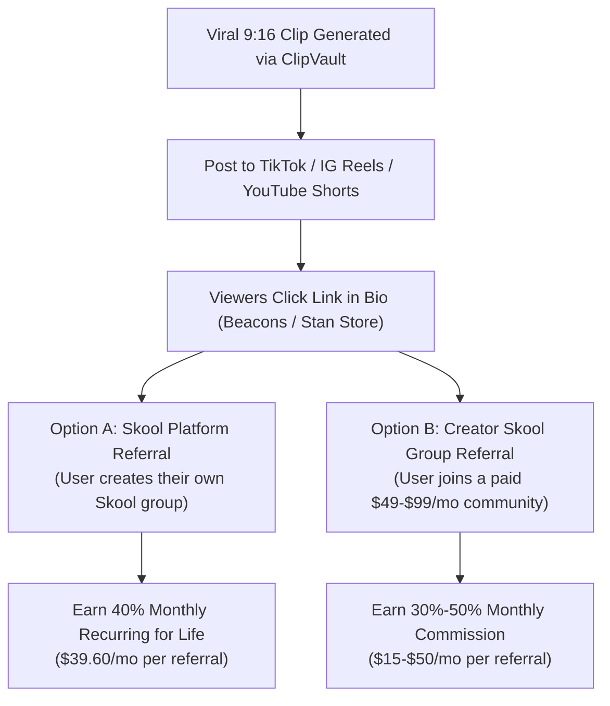

# Skool Affiliate & Community Clipping Monetization Playbook

## 1. The Strategy: Convert Podcast Clips into \$1,000+/Month Passive Income
Instead of relying on YouTube Shorts AdSense (which pays a dismal \$0.05–\$0.20 per 1,000 views), use ClipVault to create viral vertical shorts that drive viewers into high-paying **Skool affiliate communities**.

---

## 2. The Two Payout Channels



### The Math:
- 10 Platform Referrals = **\$396/month** pure recurring passive income.
- 25 Platform Referrals = **\$990/month** pure recurring passive income.
- 50 Platform Referrals = **\$1,980/month** pure recurring passive income.

---

## 3. Top High-Converting Creator Channels to Clip
Pick long-form podcasts from creators who actively speak on entrepreneurship, audience building, and community:
1. **Alex Hormozi** (Acquisition.com, co-owner of Skool).
2. **Sam Ovens** (Founder of Skool, business consulting).
3. **Iman Gadzhi** (Digital agency & online business).
4. **Chris Williamson (Modern Wisdom)** (Productivity, psychology, mindset).
5. **My First Million (Shaan Puri & Sam Parr)** (Business ideas, trends).

---

## 4. Production Workflow with ClipVault (15 Minutes Daily)

1. **Find Source**: Copy the URL of a recent 1-hour podcast episode from one of the creators above.
2. **Launch ClipVault**:
   ```powershell
   npm run consumer
   ```
3. **Configuration**:
   - Aspect Ratio: `9:16 (Vertical)`
   - Layout: `Face Tracking Auto-Reframe` (or `Podcast Split` if 2 speakers)
   - Caption Style: `Beast Mode` or `Hormozi / Bold Yellow`
   - Resolution: `1080p`
4. **Generate**: Click **Generate Clips**. ClipVault processes 10 clips in under 5–7 minutes with pre-scored viral hooks.
5. **Publish**: Post 2–3 clips daily across TikTok, YouTube Shorts, and Instagram Reels.

---

## 5. Link-in-Bio & Call-To-Action (CTA) Strategy

### Profile Bio Template:
> *Daily business insights from top 1% founders 💡*  
> *Build your own community & audience for free 👇*  
> *[your-skool-link.com]*

### In-Video Call to Action:
- Add a pinned comment on every video:  
  *"Full mastermind & resources in bio 👆"*
- In ClipVault, select the **Hook Subtitle** option so the punchline is clear within the first 3 seconds.
