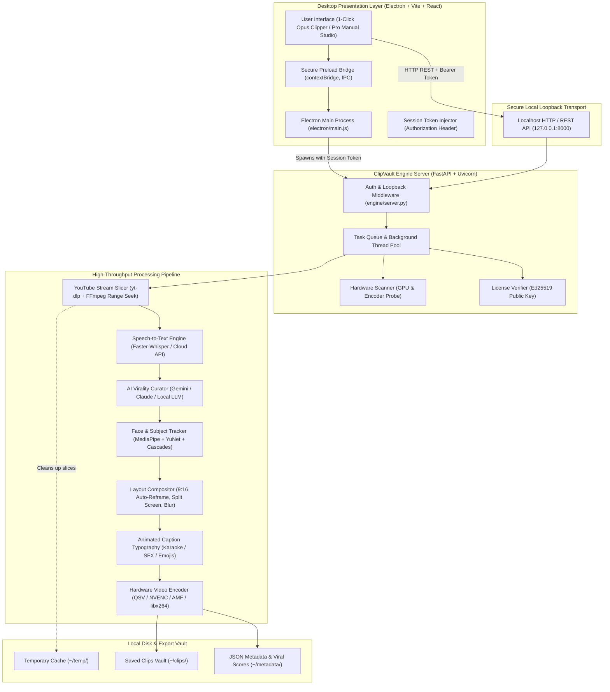
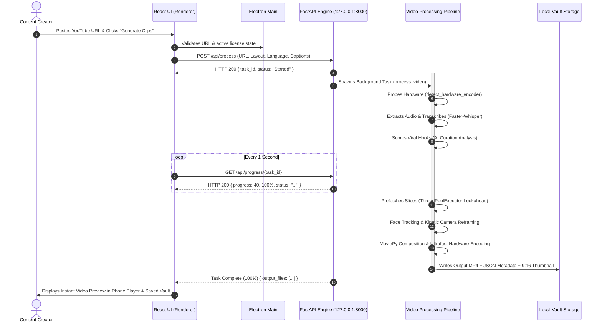

# System Architecture & Component Interaction Flowchart

## 1. Overview
ClipVault is a hybrid desktop application designed with a high-performance decoupled architecture:
- **Presentation Layer**: Electron Shell + React 18 + Vite (Tailwind CSS, TypeScript).
- **Core Orchestration & AI Engine**: Python 3.10–3.14 + FastAPI + Uvicorn (local loopback server).
- **Hardware & Media Acceleration Pipeline**: OpenCV 5.0, FFmpeg 7.1, Intel QSV / NVIDIA NVENC / AMD AMF hardware codecs, Faster-Whisper, and MediaPipe TFLite Neural Detectors.
- **Security & Authorization**: Cryptographic session tokens, loopback CORS protection, and Ed25519 offline digital signature verification.

---

## 2. System Architecture Flowchart

---

## 3. Component Communication Sequence Diagram

---

## 4. Key Architectural Highlights
1. **Decoupled Lifecycle**: The UI and Python backend run as separate processes connected via secure local loopback. If the UI reloads, active video rendering in Python continues without crashing.
2. **Local-First Privacy**: Video frames, audio, and transcripts are processed on the user's local machine; no raw user video content is sent to third-party cloud render farms.
3. **Hardware Fallback Chain**: Automatically probes for Intel QSV, NVIDIA NVENC, and AMD AMF hardware encoders, with fail-safe zero-crash fallback to multi-threaded CPU `libx264 ultrafast`.
