# Video Clipping Pipeline Flowchart

## 1. Overview
This document outlines the end-to-end execution flow of `engine/services/video_processor.py`, showing how a 1-hour YouTube stream or long-form video file is transformed into 10 viral vertical 9:16 clips in under 5–7 minutes.

---

## 2. Pipeline Flowchart

```mermaid
flowchart TD
    Start(["Input: Video URL or Local File"]) --> Probe["Phase 1: Metadata & Audio Ingestion"]
    
    subgraph Phase_1 ["Phase 1: Ingestion & Transcription (0% - 35%)"]
        Probe --> GetMeta["Fetch Video Metadata & Duration (yt-dlp)"]
        GetMeta --> ExtractAudio["Extract Master Audio Track (16kHz WAV)"]
        ExtractAudio --> Transcribe["Faster-Whisper Word-Level Alignment"]
        Transcribe --> WordTimings["Pre-computed Millisecond Word Map"]
    end

    subgraph Phase_2 ["Phase 2: AI Virality Curation (35% - 40%)"]
        WordTimings --> AIAnalysis["Analyze Transcript via AI (Gemini / Claude / Local)"]
        AIAnalysis --> HookDetect["Identify High-Retention Dialogue & Story Arcs"]
        HookDetect --> ScoreClips["Compute Virality Scores (0-100 pts)"]
        ScoreClips --> Specs["Generate Top N Clip Specifications (start, end, hook)"]
    end

    subgraph Phase_3 ["Phase 3: Parallel Slicing & Background Lookahead (40% - 50%)"]
        Specs --> InitPool["Initialize Slice Prefetch Pool (ThreadPoolExecutor)"]
        InitPool --> PrimeSlices["Prime Slices 1 & 2 (Resolution-Matched 1080p/720p)"]
    end

    subgraph Phase_4 ["Phase 4: Per-Clip Rendering Loop (50% - 98%)"]
        PrimeSlices --> LoopStart{"Clip i of N"}
        LoopStart --> QueueAhead["Submit Lookahead Slice (i + 2) in Background"]
        QueueAhead --> GetSlice["Retrieve Slice (Instant Prefetch Hit)"]
        
        GetSlice --> FastCut["Scene Cut Detector (cap.grab() Forwarding)"]
        FastCut --> FaceTrack["AI Face Tracking & Camera Director (Pass 1 & 2)"]
        FaceTrack --> ComposeLayout["Apply Layout (Auto-Reframe, Split Screen, Blur)"]
        ComposeLayout --> Captions["Overlay Animated Word-by-Word Typography"]
        Captions --> Music["Optional BGM Auto-Ducking (0.18-0.35 Vol Under Voice)"]
        Music --> Encode["Hardware Acceleration Encode (QSV / NVENC / AMF / ultrafast)"]
        Encode --> SaveMeta["Save Structured JSON & TXT Metadata"]
        SaveMeta --> GenThumb["Generate 9:16 Portrait Thumbnail with Headline"]
        GenThumb --> NextCheck{"More clips?"}
        NextCheck -- Yes --> LoopStart
        NextCheck -- No --> Cleanup["Phase 5: Finalization & System Reclaim"]
    end

    subgraph Phase_5 ["Phase 5: Finalization (98% - 100%)"]
        Cleanup --> FreeMem["Release GPU & Reclaim RAM (gc.collect(), SystemGuard)"]
        FreeMem --> Finish(["Output: N Finalized Viral Clips in Saved Vault"])
    end
```

---

## 3. Pipeline Optimizations Summary

| Stage | Optimization Technique | Throughput Gain |
| :--- | :--- | :--- |
| **Stream Slicing** | Precision resolution matching (downloading 1080p instead of 4K master) | $5\times$ bandwidth & frame decode reduction |
| **Lookahead Queue** | `ThreadPoolExecutor(max_workers=2)` prefetching clip $i+1$ while clip $i$ renders | Eliminates 100% of network latency between clips |
| **Face Tracking** | Keyframe downsampling capped at max 20 samples per clip | Reduces pre-scan seeks from 264 (300s) to <4s ($40\times$ speedup) |
| **Scene Detection** | Replaced OpenCV `cap.set()` seeking with sequential `cap.grab()` forwarding | Reduces cut scan from 15s to 0.5s |
| **Video Encoding** | Preset optimization (`ultrafast`) across QSV/NVENC/CPU | Increases frame render rate from ~50 FPS to **140 FPS** |
