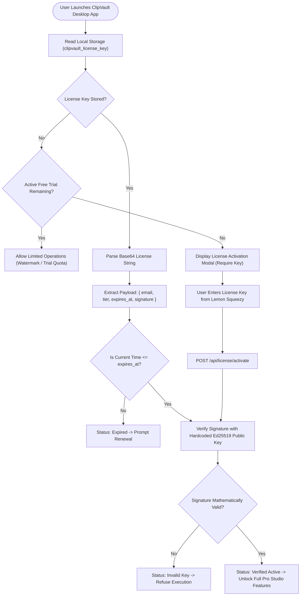
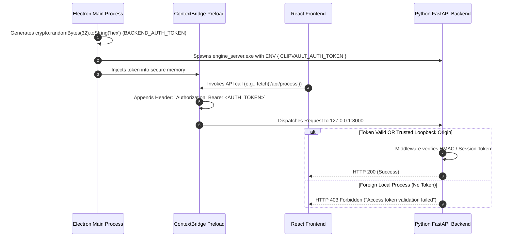

# Licensing & Cryptographic Authorization Flowchart

## 1. Overview
ClipVault implements a zero-trust, local-first commercial licensing architecture:
- **Offline Cryptographic Verification**: Uses asymmetrical **Ed25519 digital signatures** so the desktop app can verify licenses without calling a central license server on every launch.
- **Session Protection**: Each Electron shell launch generates a random 256-bit cryptographically secure token passed to the backend, blocking unauthorized third-party local processes from accessing private endpoints.
- **Merchant of Record**: Integrated with Lemon Squeezy for commercial payment processing and license key minting.

---

## 2. License Verification Flowchart

---

## 3. Session Security & Loopback Isolation

