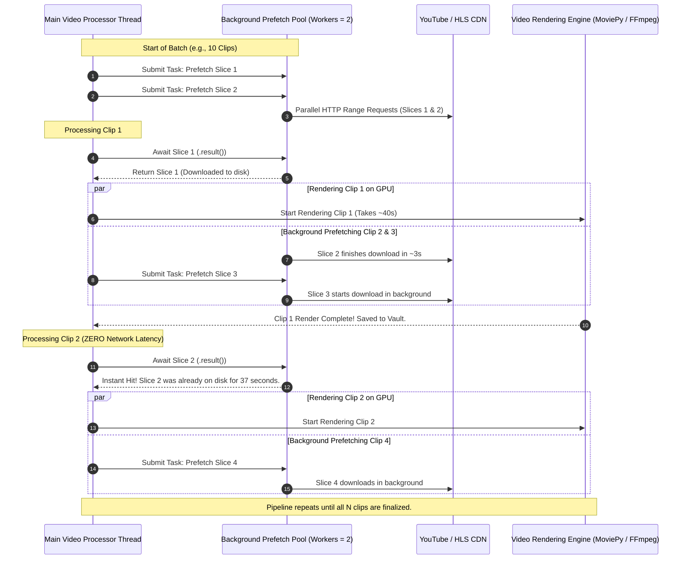

# Parallel Lookahead Prefetching Flowchart

## 1. Overview
In standard video processing pipelines, network downloads and GPU rendering are strictly sequential:
$\text{Download 1} \rightarrow \text{Render 1} \rightarrow \text{Download 2} \rightarrow \text{Render 2} \dots$
This causes the network card to sit 100% idle for 40–60 seconds while a clip renders, and conversely causes the GPU to sit 100% idle while the next clip downloads.

ClipVault solves this through an asynchronous **Lookahead Prefetching Pipeline** using a dedicated `ThreadPoolExecutor(max_workers=2)`.

---

## 2. Prefetching Execution Flowchart

---

## 3. Concurrency Safety Rules
1. **Thread-Safe Filenames**: Each prefetched slice file incorporates a unique hexadecimal UUID (`seg_v_{id}_{st}_{et}_{uuid}.mp4`) to prevent race conditions or overwriting between simultaneous downloads.
2. **Graceful Shutdown**: On cancellation or batch completion, `prefetch_executor.shutdown(wait=False, cancel_futures=True)` immediately aborts pending network tasks and unlinks unrendered slice files from disk.
3. **Silent Progress Decoupling**: Background prefetch threads run without touching the main UI progress bar, ensuring foreground render percentages remain strictly smooth and continuous.
